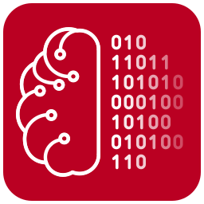

  

The app is now called **brAInStream**, in one word.

## The name

| | 0.5.0 | 0.5.1 |
|---|---|---|
| App | brAIn stream | brAInStream |
| macOS app | brAIn stream.app | brAInStream.app |
| Packages | `brAInstream-<version>-…` | `brAInStream-<version>-…` |
| Default projects folder | `~/brAIn stream` | `~/brAInStream` |
| Validation marker stream | `brAInstreamValidation` | `brAInStreamValidation` |

The `brainstream` command is unchanged. The documentation and older release
notes no longer say "brAIn dump".

## Upgrading

- **Install brAInStream** as usual.
- **Settings and recent projects** move over the first time it starts, from
  0.5.0 (*brAIn stream*) or earlier (*brAIn dump*).
- **Projects** from any earlier version open as they are.
- **Validation recordings** made with 0.5.0 or earlier are still read by the
  analysis.
- **The old app** stays installed until you remove it: delete *brAIn stream*
  from Applications (macOS), or run its uninstaller (Windows, Linux).
- **On macOS**, allow camera access once more for the new app.

## Install

The Windows zip, the macOS DMG (Apple Silicon, macOS 14+) or the Linux tarball
(x86_64, glibc 2.34+). The first launch downloads g.Pype 4.2, g.tec's drivers
(gtec-unicorn, gtec-gds), OpenGP3, MediaPipe, NDI and the other libraries
from PyPI.
